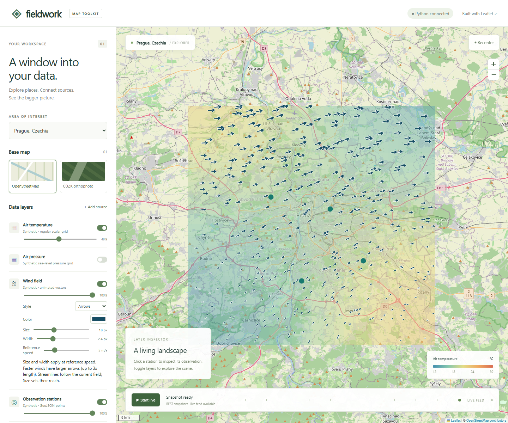

# Fieldwork

A small, extensible Leaflet viewer for data you serve. Plain HTML, JavaScript modules, local Leaflet assets, and an optional Flask backend. No Node build, CDN scripts, API keys, or frontend framework.



## Run

Python 3.10+:

```sh
python -m venv .venv
# Windows: .venv\Scripts\activate
# macOS/Linux: source .venv/bin/activate
pip install -r requirements.txt
python app.py
```

Open **http://127.0.0.1:5000**. The root entry point is `index.html`.

For **static hosting**, upload `index.html`, `config.json`, and `static/` together. For a local static server:

```sh
python -m http.server 8000
```

Open **http://127.0.0.1:8000**. Static mode automatically uses bundled snapshots for all three locations. Layer controls, animated wind, GeoJSON/KML, inspection, custom HTTP sources, and basemap selection still work. Python ingestion and the live SSE stream require Flask. Serve over HTTP rather than opening a `file://` URL. Hosting under a subdirectory works for bundled assets and snapshots.

JavaScript and CSS libraries are served locally. OSM and ČÚZK imagery still need internet; this is not an offline map tile bundle.

## What is included

- Prague, Brno, and Krkonoše presets in JSON.
- OpenStreetMap XYZ and ČÚZK orthophoto WMS basemaps.
- Synthetic temperature, air pressure, and elevation grids, animated wind particles, GeoJSON stations and a sample trajectory.
- Layer visibility and opacity, feature inspection, summaries in the left sidebar.
- A session-only **Add source** dialog for GeoJSON, scalar grids, wind grids, KML, XYZ, and WMS.
- REST snapshots, a local REST producer ingress, and browser Server-Sent Events with automatic reconnect.
- Python synthetic and Open-Meteo provider examples.

All built-in weather, terrain, station, and route data is **illustrative**, not real observations. The route follows an illustrative path near the chosen preset, not surveyed river geometry. The optional Open-Meteo example supplies a real forecast point; it does not turn one point into a measured temperature surface.

## Configuration and reuse

Edit `config.json`. Locations use Leaflet `center: [latitude, longitude]`; GeoJSON and grid bounding boxes use longitude first.

```json
{
  "id": "my-stations",
  "name": "My observations",
  "type": "geojson",
  "url": "https://your-server.example/stations.geojson",
  "enabled": true,
  "color": "#187a70",
  "opacity": 1,
  "description": "My REST provider"
}
```

Add a definition to `layers`, or use the dialog to try it for the current session. External endpoints need CORS and HTTPS when the viewer is HTTPS. For static hosting, use relative URLs such as `data/stations.json`. The built-in `/api/data/<id>` paths are the only URLs automatically mapped to bundled snapshots in static mode.

Supported layer types: `geojson`, `kml` (Point and LineString placemarks), `grid`, `wind`, `xyz`, `wms`. WMS needs `layers`; XYZ supports `{z}/{x}/{y}`. Include `attribution` for map services. This small KML adapter does not support polygons, styles, NetworkLinks or gx:Track; convert those with a full GIS tool first.

The reusable module `static/toolkit.js` exports `createLayer`, `GridLayer`, `validateGrid`, `gridSample`, and `kmlToGeoJSON`:

```js
import { createLayer } from "./static/toolkit.js";
const layer = createLayer(
  { type: "grid", opacity: 0.5 },
  await fetch("temperature.json").then((r) => r.json()),
);
layer.addTo(map);
```

No provider HTML is injected. Summary labels, values, feature properties, and tooltips render as text.

## Data contracts

**Features:** use standard RFC 7946 GeoJSON in WGS84, preferably a FeatureCollection. Points, lines and polygons are handled by Leaflet. A top-level optional summary populates a panel:

```json
{
  "type": "FeatureCollection",
  "features": [],
  "summary": { "label": "Stations online", "value": "4 / 4" }
}
```

**Grids:** Fieldwork uses `map-viz.grid/v1` as its existing wire-format identifier. This is an intentionally small project-specific interchange contract, **not an OGC standard**:

```json
{
  "schema": "map-viz.grid/v1",
  "crs": "EPSG:4326",
  "bbox": [14.2, 49.9, 14.7, 50.2],
  "width": 2,
  "height": 2,
  "rowOrder": "south-to-north",
  "unit": "°C",
  "values": [18, 19, 20, null],
  "summary": { "label": "Mean temperature", "value": "19 °C" }
}
```

Bounds are **sample centers** at the west/south and east/north extremes. Arrays are flattened row-major: west → east, then south → north. `null` means nodata. Grids require 2–512 samples per axis. Scalar rendering uses nearest-neighbor sampling; this is a surface visualization rather than a point-kernel heatmap. Temperature colors currently span 12–30 °C; synthetic elevation spans 150–700 m. Adapt `GridLayer.draw` for another quantity or palette.

**Wind:** use the same metadata, replacing `values` with `u` and `v` arrays. `u` is eastward velocity and `v` is northward velocity in m/s. Convert meteorological “from” bearings before sending components. Particles show a direction field, accelerated in screen space for readability; they are not geographic parcel integration or a quantitative trajectory simulation.

**DEM / large rasters:** use this JSON contract for small downsampled prototypes. For production rasters, retain a georeferenced Cloud Optimized GeoTIFF (COG), and expose rendered XYZ tiles or WMS/WMTS via a raster server such as TiTiler or GeoServer. Add those as tile layers; this demo does not decode GeoTIFF, NetCDF or GRIB in the browser. Reproject to a display CRS in the raster server and retain nodata, units, timestamps and provenance. For weather cubes, keep NetCDF/Zarr/GRIB upstream and serve a requested time slice or rendered tiles. WMS supplies imagery; it does not automatically expose numerical values for client-side sampling.

Useful primary references: [GeoJSON RFC 7946](https://www.rfc-editor.org/rfc/rfc7946), [OGC COG](https://www.ogc.org/standards/cog/), [OGC WMS](https://www.ogc.org/standards/wms/), [TiTiler](https://developmentseed.org/titiler/).

## Python providers and live mode

`providers.snapshot(kind, location)` demonstrates the smallest provider interface: return a JSON-serializable snapshot. REST clients can request:

```text
GET /api/config
GET /api/data/temperature?location=prague
GET /api/data/wind?location=brno
GET /api/data/stations?location=prague
GET /api/events?location=prague
POST /api/push/temperature?location=prague
```

A successful POST replaces the latest snapshot **in memory** for that location and layer. The SSE demo broadcasts all six latest snapshots every three seconds, using synthetic data until a provider pushes a replacement. Enable **Start live** in the UI to receive those frames; snapshot mode reads once on location selection. **Pause live** closes the connection and retains the last rendered state. External/custom URL layers are loaded as snapshots and are not subscribed to the built-in stream.

Run an independent REST producer:

```sh
python examples/push_provider.py --location prague --interval 5
```

Or fetch and push an Open-Meteo forecast point:

```sh
python examples/open_meteo.py
```

Open-Meteo attribution: weather data by [Open-Meteo](https://open-meteo.com/), [CC BY 4.0](https://creativecommons.org/licenses/by/4.0/). Check [API terms](https://open-meteo.com/en/terms) for your use. [API documentation](https://open-meteo.com/en/docs) describes variables and units.

REST + SSE is the implemented transport: browsers consume HTTP directly, including infrequent updates and reconnects. ZeroMQ is an optional upstream architectural choice, not a dependency here: run a Python SUB bridge that receives your messages and POSTs snapshots to the ingress. For a sparse production stream, replace the demo timer with a per-subscriber queue and heartbeat comments, adding event IDs/replay when needed. The current stream sends whole snapshots, has no historical replay, and does not synchronize across multiple Flask processes.

The local server binds to loopback. Ingress has a 2 MB request limit and basic grid checks, but no authentication, persistence, rate limiting, or complete GeoJSON validation. Keep it local; add those controls before using it as a shared service. It is a toolkit demo, not a production deployment template.

## Develop and verify

Pinned Leaflet 1.9.4 is checked in under `static/vendor/`, including its BSD license. To refresh it and demo data:

```sh
python tools/vendor_assets.py
python tools/build_static.py
```

The vendor helper verifies published JS/CSS SHA-256 values. Third-party code retains its own license; project code uses MIT.

```sh
pip install pytest playwright
python -m playwright install chromium
python -m pytest -q
python tests/verify_browser.py
```

The browser check runs temporary Flask and static servers, checks live events, layers, a custom source, location switching and mobile overflow, and writes `docs/screenshot.png` and `docs/mobile.png`. It shuts down its servers afterward.

Basemap references: [Leaflet](https://leafletjs.com/), [OSM tile usage policy](https://operations.osmfoundation.org/policies/tiles/), [ČÚZK orthophoto WMS](https://ags.cuzk.gov.cz/arcgis1/services/ORTOFOTO/MapServer/WMSServer?SERVICE=WMS&REQUEST=GetCapabilities). External service availability, terms, and coverage belong to their respective providers.

### Wind appearance

The wind layer has live controls for **Style** (Arrows, Stream trails, Particles), **Color**, **Size** (6-40 px), and **Width** (1-6 px), alongside opacity. Defaults use dark blue arrows with a light outline for contrast over both basemaps. Wind is drawn above scalar grids. Changes survive live frames and location changes for the current session.

Persist defaults in a wind layer definition using `color`, `opacity`, `windStyle` (`arrows`, `trails`, `dots`), `windSize`, and `windWidth`. The same options work with `createLayer`; an existing wind layer also exposes `setWindStyle({color, windStyle, windSize, windWidth})`.

### Speed scaling and streamlines

Arrow length is proportional to `hypot(u, v) / windReference` (capped at 3x); arrowhead size scales with length and line width scales with the square root of that ratio. Calm wind is omitted. Particle size and trail glyph length also reflect speed. The **Reference speed** control (default 5 m/s, config `windReference`) defines the speed represented by the Size and Width controls. Changing reference speed adjusts visual scaling without modifying data.

Choose **Streamlines** (`windStyle: "streamlines"`) to integrate curves forward and backward through the instantaneous vector field, with downstream arrowheads. This uses bilinear interpolation and midpoint integration in the Leaflet Mercator view, stops at calm/nodata/bounds, and redraws on data, appearance, and map changes. Size controls integration reach, Width controls line thickness, and Color/Opacity work as in other wind styles. Streamlines show direction geometry, not time-dependent parcel trajectories; their length does not encode speed. **Stream trails** remains a separate animated mode. All modes work in static hosting.

Streamlines are animated with moving pulses over faint continuous curves. Pulses move downstream at a rate proportional to local wind magnitude (with a visual acceleration factor), using cached curve geometry and travel times. Geometry is rebuilt only when data, map, or appearance changes. Animation runs in static mode too; it visualizes the instantaneous field, not a time-dependent physical trajectory.

### Air pressure

Enable **Air pressure** for a synthetic sea-level pressure surface in hPa, using a blue-to-purple palette (995-1035 hPa). It has its own legend and mean-pressure summary and works through REST (`/api/data/pressure`), push ingress, SSE, and bundled static snapshots. Disable temperature to view pressure alone or adjust opacity to compare overlays. Pressure is illustrative, not a forecast.

Scalar layer definitions can now set `range: [min, max]` and `palette: ["#355c9a", "#d9e0eb", "#87468e"]` using RGB hex colors. These options control both raster colors and the matching legend.

Wind glyph dimensions are in CSS screen pixels, independent of map zoom. The wind canvas sits in a viewport pane outside Leaflet's transformed map pane. During map movement it is briefly hidden and rebuilt at the new view; speed scaling continues to reflect the underlying field.

## Embed in your own page

Open **http://127.0.0.1:5000/examples/embed.html** (or port 8000 with a static server) for a complete host-page example. It embeds the viewer without the Fieldwork header/sidebar, location panel, description inspector, legend or live toolbar. Attribution remains visible; zoom and scale controls are retained.

```html
<iframe
  src="/index.html?config=examples/embed.json"
  title="Fieldwork map of Prague"
  style="width:100%;height:560px;border:0"
></iframe>
```

`examples/embed.json` is a standalone configuration containing locations, basemaps, active layers, source URLs, and styles, including pressure palette/range and wind appearance. Copy it for another view, then set `?config=path/to/your.json`. Config paths and relative layer URLs resolve against the viewer document, not the host page or the config file. If Fieldwork is hosted under a subdirectory, include that subdirectory in the iframe URL. For cross-origin embedding, use the full viewer URL; the host does not need access to iframe internals. The viewer host must permit framing and external data services must permit CORS.

The regular `config.json` also supports these options:

```json
{
  "initialLocation": "prague",
  "initialBasemap": "osm",
  "live": false,
  "ui": {
    "header": false,
    "sidebar": false,
    "location": false,
    "recenter": false,
    "inspector": false,
    "toolbar": false,
    "legend": false,
    "zoom": true,
    "scale": true
  }
}
```

This is the UI portion of a config: include `locations`, `basemaps` and `layers` as shown in the full example. Each `ui` option defaults to true. Layer `enabled`, `url`, `type`, `opacity`, `color`, `range`, `palette`, and wind options choose the visible data and presentation. Set `live: true` to start backend streaming automatically even with a hidden toolbar; static mode retains snapshots. As a quick alternative, `index.html?embed=1` hides the surrounding UI using the default config; it can be combined with `?config=examples/embed.json&embed=1`.

If you prefer direct JavaScript integration without an iframe, create your own Leaflet map element and import `createLayer` from `static/toolkit.js` as shown under Configuration and reuse. Your host page owns its layout and controls.
